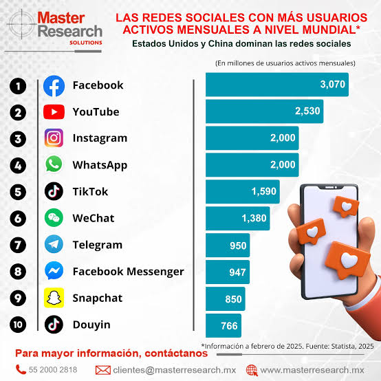
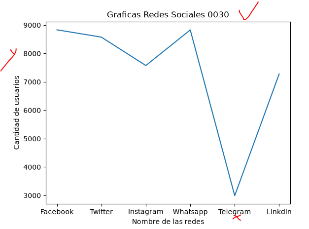
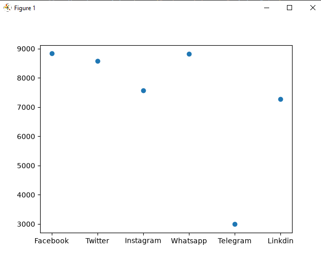
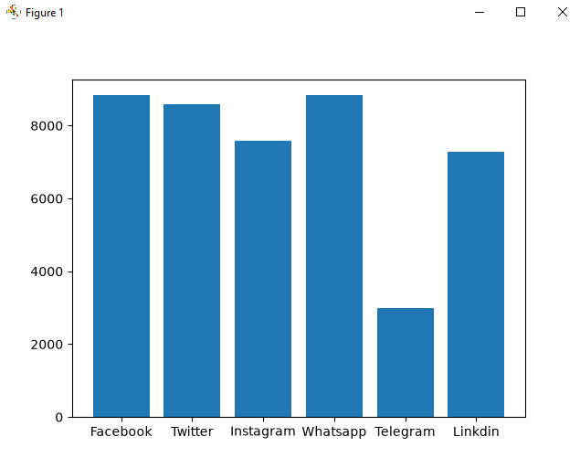
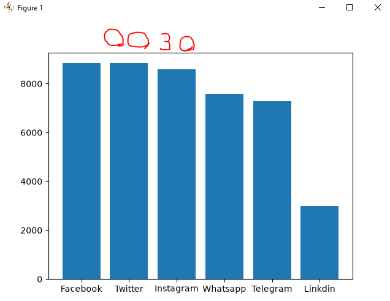
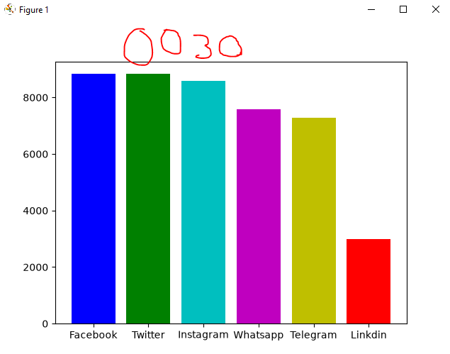
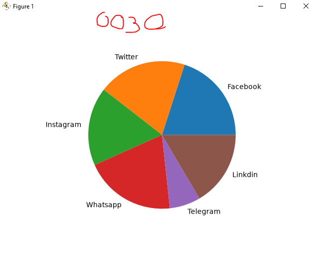

## DataFrame o marco de datos pandas

## Redes Sociales a nivel global / Redes Sociales mas usadas en 2025

## Grafica de redes sociales

## Grafica puntos redes sociales

## Grafica de barras de redes sociales

## Grafica de Barras del mas Grande al mas Pequeño Descedente

## Coloreando las Graficas

## Grafica de pastel o pie
